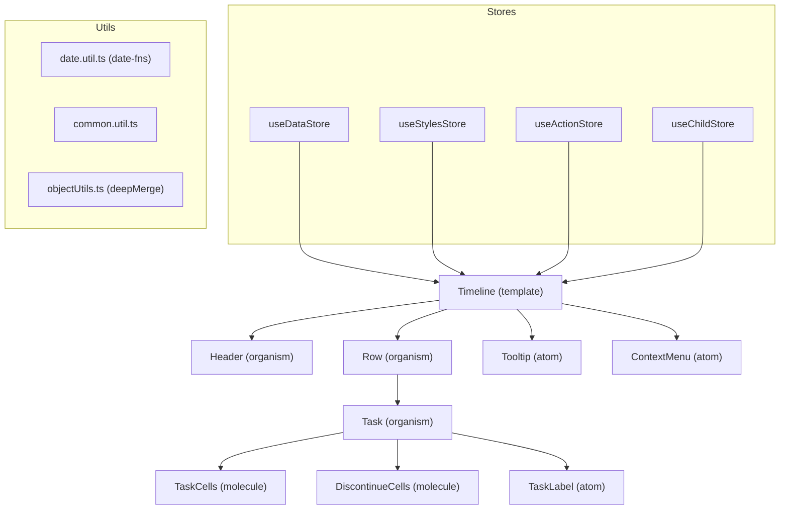

# AGENTS.md — React Timeline Scheduler

> **Read this file first** before modifying any code in this repository.
> It is maintained as the single source of truth for AI agents and contributors.

---

## Project Purpose

**npm package**: `react-timeline-scheduler`
**Current version**: `1.2.1`
**License**: MIT

A responsive, customizable Gantt-style timeline scheduler component for React 18/19.
Consumers pass tasks with `startDate`/`endDate` and get a draggable, resizable timeline.

---

## Tech Stack

| Tool | Version | Role |
|---|---|---|
| React | 18/19 (peer) | UI framework |
| TypeScript | ~5.6 | Strict mode; no `any` |
| Zustand | ^5 | Global state (4 stores) |
| framer-motion | ^12 | Animations |
| date-fns | ^3.6 | Date utilities (NO moment) |
| Tailwind CSS v4 | ^4 (peer) | Styling |
| Vite | ^6 | Build tool |
| Vitest | ^4 | Test runner |

**Banned dependencies**: `moment`, `lodash` — do not add them back.

---

## Folder Map

```
src/
├── index.ts                        # Public API — all exports live here
├── index.css                       # Global Tailwind entry
├── types/
│   ├── scheduler.types.ts          # All public TypeScript interfaces
│   └── index.ts                    # Re-exports
├── stores/
│   ├── index.ts                    # Re-exports all 4 stores
│   ├── actionStore.ts              # Callbacks + drag/anim config
│   ├── childStore.ts               # Tooltip + right-click state
│   ├── dataStore/                  # Scheduler data + date ranges
│   │   ├── index.ts
│   │   ├── dataStore.ts
│   │   └── startEndDates.ts        # Pure helper (date computation)
│   └── stylesStore/                # Theme + cell dimensions
│       ├── index.ts
│       ├── stylesStore.ts
│       └── themeHelpers.ts         # deepMerge for themes
├── data/
│   ├── styles/defaultTheme.ts      # Light/dark theme tokens
│   └── demo/                       # Dev-only demo page
├── util/
│   ├── date.util.ts                # date-fns helpers (NO moment)
│   ├── common.util.ts              # generateGroupedTasks
│   └── objectUtils.ts             # deepMerge utility
├── components/
│   ├── atoms/                      # Smallest building blocks
│   │   ├── ContextMenu/            # Right-click menu (role="menu")
│   │   ├── Tooltip/                # Hover tooltip (role="tooltip")
│   │   ├── TaskLabel/              # Task name label
│   │   ├── HeaderComponent/        # Icon buttons, labels
│   │   └── ...
│   ├── molecules/                  # Composite components
│   │   ├── TaskComponent/          # TaskCells, DiscontinueCells, etc.
│   │   ├── HeaderComponent/        # DateCell, MonthHeader
│   │   └── ActionsUI/             # RightClickUI, TaskActionButtons
│   ├── organisms/
│   │   ├── Header/                 # Sticky date header
│   │   │   ├── index.tsx
│   │   │   ├── useHeader.ts        # State + effects
│   │   │   └── HeaderLayout.tsx    # JSX render
│   │   ├── Row/                    # Data row (label + task cells)
│   │   │   ├── index.tsx
│   │   │   └── RowLayout.tsx
│   │   └── Task/                   # Individual task bar
│   │       ├── index.tsx
│   │       ├── useTaskDrag.ts      # Drag/resize logic
│   │       ├── useTaskColors.ts    # Color computation
│   │       └── TaskBody.tsx        # JSX render
│   └── templates/
│       └── Timeline/               # Top-level component
│           ├── index.tsx           # Prop merging + export
│           ├── useTimeline.ts      # Store wiring + effects
│           ├── TimelineView.tsx    # Main JSX layout
│           └── TimelineError.tsx   # Error/loading states
└── __tests__/
    └── filesize.test.ts            # Enforces ≤100 line rule
```

---

## Architecture Diagram



---

## Store Responsibilities

| Store | File | Manages |
|---|---|---|
| `useDataStore` | `stores/dataStore/` | `schedulerData`, `tableStartDate`, `tableEndDate`, offset days |
| `useStylesStore` | `stores/stylesStore/` | theme, cell dimensions, `rowLabelMaxWidth`, `borderColor` |
| `useActionStore` | `stores/actionStore.ts` | callbacks (`onTaskClick`, etc.), `dragConfig`, `animationConfig`, `lockOperations` |
| `useChildStore` | `stores/childStore.ts` | tooltip state, right-click task |

---

## Mandatory Coding Rules

> Violations in PRs will be rejected.

1. **≤ 100 lines per file** — split any file that reaches 101+ lines
2. **No `moment`** — use `date-fns` functions: `addDays`, `differenceInDays`, `isBefore`, `isAfter`, `isValid`, `format`, `parseISO`
3. **No `lodash`** — use native JS or the `deepMerge` util in `src/util/objectUtils.ts`
4. **TypeScript strict mode** — no `any`, no `!` non-null assertions without prior null guards
5. **A11y required** — ARIA roles, keyboard handlers, focus management, WCAG 2.1 AA
6. **Keep all public exports** — `src/index.ts` is the public API surface; never remove exports

---

## Known Bugs & Pitfalls

- **`setSchedulerData` bug (FIXED v1.2.1)**: Previously passed old `state.schedulerData.tasks` to `startEndDates`. Now correctly passes the new `tasks` argument.
- **`startEndDates` offsets (FIXED v1.2.1)**: Previously hardcoded 2-day offset, ignoring `startOffsetDays`/`endOffsetDays` params. Fixed to `addDays(minStart, -Math.abs(startOffsetDays) - 2)`.
- **`rowLabelMaxWidth` typo (FIXED v1.2.1)**: Was `rowLableMaxWidth` throughout. All references updated.
- **`setRightClickTask` casing (FIXED v1.2.1)**: Was `setrightClickTask`. All call sites updated.
- **Re-render issue**: `handleMouseMove` in Timeline was recreated every render. Now wrapped in `useCallback`.
- **Double sort**: `Object.keys(groupedTasks).sort(...)` was called twice per render. Now uses `sortedKeys` useMemo.
- **Virtual scrolling**: Not implemented. Add a TODO when row count exceeds ~200. Known perf cliff.

---

## UX Standards

| State | Component | Implementation |
|---|---|---|
| Loading | `TimelineError.tsx` | Animated skeleton pulse bars (Tailwind only) |
| Error | `TimelineError.tsx` | Styled error card with icon + message |
| Empty row | `RowLayout.tsx` | Subtle "No tasks" placeholder text |
| Today highlight | `DateCell` | Pulsing blue indicator line |
| Resize cursor | Task handles | `cursor-col-resize` on hover (CSS) |

For future UX additions: always use Tailwind classes only (no new CSS deps), and add the pattern to this table.

---

## Public API Surface

```ts
// TimelineProps (all optional except none required)
interface TimelineProps {
  config?: SchedulerConfig;      // Alternative to individual props
  label?: string;                // Header label (default: "Timeline")
  data?: SchedulerTask[];        // Tasks array
  startOffsetDays?: number;      // Days before first task (default: 0)
  endOffsetDays?: number;        // Days after last task (default: 0)
  resources?: string[];          // Force-show empty resource rows
  styles?: SchedulerConfigStyles;
  theme?: Partial<SchedulerTheme> | SchedulerThemeConfig;
  dragConfig?: DragConfig;
  animationConfig?: AnimationConfig;
  disableToolbar?: boolean;      // Disable toolbar buttons (default: false)
  scrollIntoToday?: boolean;
  loading?: boolean;
  loadingComponent?: React.ReactNode;  // Custom loading UI
  errorComponent?: React.ReactNode;    // Custom error UI
  emptyComponent?: React.ReactNode;    // Custom empty row UI
  rightClickOptions?: ContextMenuType[];
  onTaskClick?: (task: SchedulerTask) => void;
  onRowExpand?: (groupLabel: string, groupId: string, task: SchedulerTask) => Promise<void>;
  onRowShrink?: (groupLabel: string, groupId: string, task: SchedulerTask) => Promise<void>;
  onRowLabelClick?: (groupLabel: string) => void;
  tooltipComponent?: (task: SchedulerTask, index?: StripIndex) => React.ReactNode;
  className?: string;
}
```

---

## Bundle Size Targets

- Production JS bundle: **< 50 KB gzipped** (excluding React, ReactDOM, Tailwind peer deps)
- Moment removal saves ~70 KB; Lodash removal saves ~71 KB
- Run `npm run build` and check `dist/` sizes after changes

---

## Conflict Resolution Guide

When renaming store keys or component symbols:
1. Use `grep -r "oldName" src/` to find ALL occurrences
2. Update the store/type definition first
3. Update all component files that import or use the symbol
4. Update tests
5. Run `npm run build` to catch remaining TypeScript errors
6. Run `npm run lint` to catch ESLint issues

When splitting a file into a folder:
1. Create the folder and new files
2. Create `index.ts` that re-exports exactly what the old file exported
3. Delete the old file
4. Update `stores/index.ts` or relevant barrel if path changed

---

## Development Commands

```bash
npm run dev      # Start Vite dev server with demo
npm run test     # Run Vitest test suite
npm run build    # TypeScript check + Vite build
npm run lint     # ESLint check
```

---

## PR Checklist

- [ ] `npm run lint` — 0 errors
- [ ] `npm run test` — all pass
- [ ] `npm run build` — clean build, no TS errors
- [ ] `npm audit` — 0 high/critical vulnerabilities
- [ ] No file in `src/` exceeds 100 lines
- [ ] No `moment` or `lodash` imports
- [ ] All new public props documented in this AGENTS.md
- [ ] A11y: ARIA roles added to any new interactive elements
- [ ] CHANGELOG.md updated
